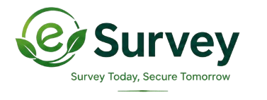
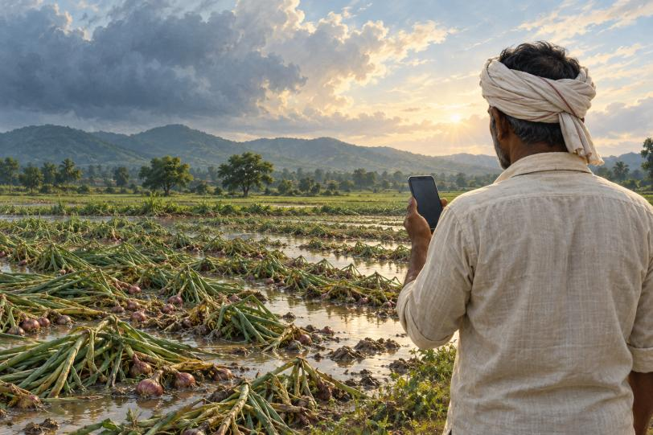
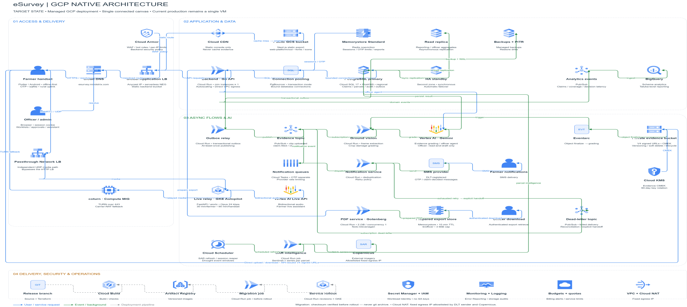
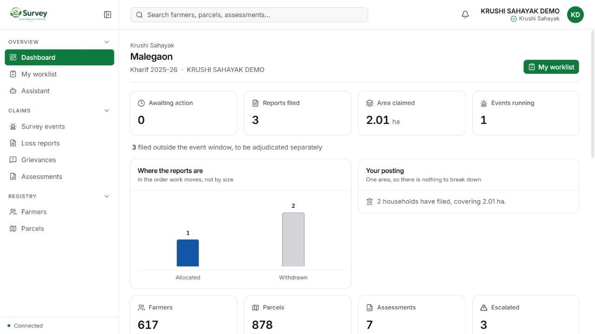

# eSurvey — Google AI for trusted crop-insurance claims

**Team Agribid** · Team leader: Aniket Dhumal
**PS1 — BFSI: Intelligent Risk, Fraud & Financial Experiences**
Google Cloud AI Builder Cup

---

## Demo video

<iframe src="https://drive.google.com/file/d/1w_wAz0uuPxLQ0Q-vxbzRQ7oo9ejN0PXF/preview" width="860" height="484" allow="autoplay" allowfullscreen></iframe>

[](https://drive.google.com/file/d/1w_wAz0uuPxLQ0Q-vxbzRQ7oo9ejN0PXF/view?usp=sharing)

**▶ [Watch the demo (3–4 minutes)](https://drive.google.com/file/d/1w_wAz0uuPxLQ0Q-vxbzRQ7oo9ejN0PXF/view?usp=sharing)** — end to end: a
farmer completing a guided self-survey in their own field, and the officer
console receiving, cross-checking and adjudicating the claim it produced.

---

## Pitch deck

<iframe src="https://docs.google.com/gview?embedded=true&url=https://raw.githubusercontent.com/Aniket-Dhumal/esurvey-builder-cup/main/docs/submission/Agribid-eSurvey-Google-AI.pdf" width="860" height="600"></iframe>

**📄 [Agribid-eSurvey-Google-AI.pdf](docs/submission/Agribid-eSurvey-Google-AI.pdf)**
— 14 slides: the problem, the verification gap, the Google Cloud workflow, the
architecture, the opportunity model and the pilot plan.

---

## Architecture



Four bands, left to right in the flow of a claim:

- **Access and delivery** — Cloud DNS, a global Application Load Balancer with
  Cloud Armor in front, Cloud CDN for the static console. A separate
  passthrough Network LB carries the live audio, because WebRTC needs UDP and a
  serverless HTTP front end cannot terminate it.
- **Application and data** — the Go API, connection pooling, Cloud SQL
  (PostGIS) with an HA standby, a read replica for reporting, Memorystore for
  sessions, and BigQuery for taluka-level analytics.
- **Async flows and AI** — Pub/Sub carries every clip upload into grading;
  Vertex AI runs Gemini for evidence grading and the officer agent; Earth
  Engine and a Cloud Run job supply the satellite series; Cloud Tasks handles
  notifications; the Live API drives the farmer conversation.
- **Delivery, security and operations** — Cloud Build, Artifact Registry,
  Workload Identity with no service-account keys, CMEK on the evidence bucket
  with 90-day key rotation, and a fixed egress IP through Cloud NAT.

This is the target state. Production today is a single connected VM running
the same containers; the diagram is the path, not a claim about what is
deployed.

---

## Details

A disaster hits lakhs of acres in a single day and the claims arrive all at
once. The evidence does not. Thousands of dispersed parcels need assessment in
the same week, repeated field visits raise cost, and genuine farmers wait in
the same queue as suspicious claims.

eSurvey is the layer that produces **the evidence**, not the payout decision.
A farmer walks their own field with the phone they already own; Gemini Live
tells them what to film; the clips are location-stamped, time-stamped and
bound to a parcel before they leave the handset. Vertex AI reads what is
visible, Earth Engine says what changed on that parcel across the season, and
Google ADK puts the two beside the registry record and names where they
disagree. The officer gets one dossier per claim instead of a folder of
photographs.

Three things separate this from the assessment tools already in the market:

- **The spike is the use case.** Fraud detection in BFSI is built for a steady
  stream. Crop-loss fraud arrives as a surge, in the two weeks after a
  calamity, in the places assessors cannot reach in time.
- **Evidence has a chain of custody.** Position is read live from the handset
  at the moment of capture, never from the image file — browsers strip EXIF and
  EXIF is trivially edited. Six provenance gates travel with every clip.
- **Nothing is auto-refused.** A gate reports "taken 340 m outside the plot",
  not "78% confident". A farmer standing on the bund of their own field is not
  a fraudster, and the officer decides.

### Demo credentials

The officer console is at **https://esurvey.mindstrix.com**. Officers sign in
with an email address and a password.

| Role | Email | Password |
| --- | --- | --- |
| Krushi Sahayak — Malegaon, Barshi | `aniket.dhumal@nest-iq.ai` | `eSurvey@#12345678` |

That account sees the Malegaon circle: 617 farmers, 878 parcels, the Kharif
2025–26 survey event and the claims filed against it. It can read a claim,
record a finding and run the officer assistant. It cannot mint accounts or
grant roles — whoever can create an officer must not also be able to approve a
payout with it, so that is a separate role by design.

The **farmer app** signs in with a one-time code sent to the handset already
in the registry, so it cannot be demonstrated from a borrowed number. The
complete farmer journey — guided capture, voice, offline queue, upload — is the
first half of the demo video above.

### Submission links

| | |
| --- | --- |
| **Live product** | https://esurvey.mindstrix.com |
| **Demo video (3–4 min)** | https://drive.google.com/file/d/1w_wAz0uuPxLQ0Q-vxbzRQ7oo9ejN0PXF/view?usp=sharing |
| **Pitch deck (PDF)** | [docs/submission/Agribid-eSurvey-Google-AI.pdf](docs/submission/Agribid-eSurvey-Google-AI.pdf) |
| **Source** | this repository |

### Team

| Area | Owner |
| --- | --- |
| Backend — Go API, PostGIS schema, capture fences | [@sharvari0311](https://github.com/sharvari0311) |
| AI services and backend — agents, evidence grading, live relay | [@Aniket-Dhumal](https://github.com/Aniket-Dhumal) |
| Web frontend — officer console | [@harale-commits](https://github.com/harale-commits) |
| Mobile app — farmer field capture | [@chaitanya-mhetre](https://github.com/chaitanya-mhetre) |

See [CONTRIBUTORS.md](CONTRIBUTORS.md).

---

## Problem severity

**5.94 lakh crop-insurance applications were rejected in Maharashtra across two
seasons.**

| Season | Applications rejected |
| --- | --- |
| Kharif 2024 | 4,67,441 |
| Rabi 2024–25 | 1,26,830 |

The reasons on record include **barren land** and **incorrect land and area
details** — both of them questions a field check answers and a form does not.
That is the gap: verification capacity does not exist at the moment the claims
arrive, so decisions get made on paper that should have been made on the
parcel.

For the size of the problem class, the Coalition Against Insurance Fraud put
the annual cost of US insurance fraud at **US$308.6 bn** in its 2022 study.
That figure covers all lines of insurance in another country, not Indian crop
losses — it is here to size the category, not to claim the number.

*Sources: Rajya Sabha Q1474, 1 August 2025 (4,67,441 + 1,26,830); Coalition
Against Insurance Fraud, 2022 study.*

### Why a disaster is the hard case

- A calamity puts thousands of parcels into assessment in the same week.
- The 72-hour localised-calamity intimation window leaves no slack for travel.
- A village officer pair cannot walk every parcel in a taluka after a
  hailstorm. The parcels are one to two hectares, dispersed, and often
  unreachable by road after the same weather that caused the loss.
- Optical satellite imagery is least useful exactly then, because cloud follows
  a cyclone. On our reference parcel a 110-day kharif window yielded four usable
  Sentinel-2 passes with a 60-day gap in the middle.

---

## Financial data

### The market this sits in

| | |
| --- | --- |
| **₹2.06 lakh crore+** | PMFBY claims paid since inception, through Rabi 2025–26 |
| **₹9,837.61 crore** | Kharif 2025 claims already paid, reported by PIB on 29 August 2026 |

*Source: PIB, 29 August 2026. Claims paid are market context — they are not
fraud losses and not software revenue.*

### The unit economics, on one portfolio

Illustrative model on a **₹200 crore claims portfolio** — 1 lakh claims at an
average claim of ₹20,000. Every input is an assumption, stated so it can be
argued with:

| Line | Assumption | Value |
| --- | --- | --- |
| Fraud exposure | 3% of portfolio value | ₹6.0 crore |
| Potential gross avoided payouts | 50% of that exposure prevented | ₹3.0 crore |
| eSurvey service fee | ₹50 per claim × 1 lakh claims | ₹0.5 crore |
| Net to the insurer, after the fee | | ₹2.5 crore |

Illustrative, not achieved savings and not a price quote. The ₹2.5 crore
excludes investigation, integration and other costs the insurer still carries.

### Who buys it

Insurers and loss assessors buy it; farmers use it. The insurer is paying for a
reviewable dossier and a shorter queue. The farmer gets a way to document a
loss without travel, a literacy barrier or an English form standing in the way.

### How a pilot would be judged

| Measure | Method | What it demonstrates |
| --- | --- | --- |
| Fraud-signal precision / recall | Adjudicated held-out cases against a rule-only baseline | Incremental value from Gemini and satellite checks |
| False refusals / missed fraud | Review of clean claims and of missed cases | Farmer harm and remaining risk |
| Confirmed avoided payouts | Officer-confirmed amounts, appeals tracked | Financial value attributable to eSurvey |
| Review time and AI cost per claim | The existing workflow compared with the assisted one | Operational benefit and cost viability |

---

## How we solve it with Google's tech stack

### One claim, coordinated across Google Cloud

| Claim stage | Google technology | Evidence produced |
| --- | --- | --- |
| Guide the farmer | **Gemini Live API on Vertex AI** | Spoken survey guidance and capture prompts |
| Secure the evidence | **Cloud Storage + Pub/Sub** | Private media with claim-linked processing events |
| Coordinate the investigation | **Google ADK on Cloud Run** | Parallel evidence checks and structured findings |
| Analyse visible damage | **Gemini + a custom model on Vertex AI** | Crop observations and validated severity estimates |
| Cross-check the timeline | **Google Earth Engine** | Parcel-level satellite observations and NDVI history |
| Prioritise officer review | **Cloud SQL + BigQuery** | Evidence dossier, decisions and portfolio trends |

### What ADK coordinates

| Agent / stage | Tool or service | Output for the dossier |
| --- | --- | --- |
| Intake and quality | Cloud Run + Cloud Storage | Required clips, claim fields, evidence coverage |
| Visual evidence | Gemini on Vertex AI | Observed crop, visible damage, clip references |
| Satellite evidence | Earth Engine tool | Dated imagery, NDVI change, quality flags |
| Record consistency | Cloud SQL / PostGIS tool | Parcel match, duplicate records, declared dates |
| Evidence synthesis | Gemini with structured output | Agreement, discrepancies, missing information |
| Decision and learning | Officer review + BigQuery | Recorded disposition and evaluation data |

### Gemini Live guides the farmer

The app checks the position, opens the camera and captures claim-linked clips
while Gemini Live speaks the instruction — *"show the affected plants, then
slowly turn toward the next survey station"* — and asks for a clearer view when
what it has been shown will not answer the question. Marathi, spoken and on
screen, falling back to Hindi and then English where a device has no Marathi
voice. Recording is local and the upload resumable, because the connection in
a field is not the connection in an office.

### Vertex AI and Earth Engine cross-check the same claim

- **Vertex AI — what is visible?** Gemini describes the crop and the damage
  evidence. A custom vision model can estimate severity once trained on
  expert-labelled field data.
- **Earth Engine — what changed?** The parcel is queried across dates:
  cloud-masked Sentinel-2 NDVI against seasonal history and the reported event
  window.
- **ADK — where do the findings disagree?** Clips, satellite dates and parcel
  records are combined, and conflicts and missing coverage are explained with
  links to the underlying evidence.
- **The insurer — what action follows?** Request another view, prioritise an
  inspection, or continue normal review. The outcome is recorded so the next
  evaluation is better.

NDVI indicates vegetation change, not cause and not payable loss. Cloud cover
and revisit timing limit what it can say, and the system is built to say so
rather than fill the gap with a number.

### The guardrails we chose to keep

- **No ground photograph, no damage figure.** Enforced in the agent and again
  in the backend, because the agent is a separate deployable and a rollback
  could change its behaviour without the backend knowing.
- **Confidence is capped at 0.60 without ground truth**, and nothing
  fast-tracks past an officer.
- **The officer assistant reads and drafts; it never decides.** It cannot
  approve, return, reassign, close, or change a figure.
- **Identity never reaches the model.** Parcel geometry and crop records do;
  farmer identifiers do not.
- **The audit log refuses UPDATE and DELETE at the database.** A log the
  application can rewrite is not evidence.

---

## What is in this repository

```
mobile-app/     Flutter farmer app — guided capture, voice, offline queue
web-platform/   Next.js officer console
backend/        Go API — identity, authorisation, registry, evidence, audit
ai-services/    Google ADK agents on Gemini — assessment, vision, officer assistant
reference_data/ the Maharashtra administrative hierarchy, from LGD
docs/           specification, architecture, field-trial record, this submission
```

The stack runs from `docker compose up --build` against a local Postgres
(PostGIS) and Redis. `docs/` carries the setup, the production topology and the
security review.

**Registry data is not in this repository.** Farmer records and parcel
geometry describe real people and their land, so they are supplied at run time
from a directory outside the tree and never committed. See
`mock_files/README.md` for the shape the loader expects.

### What is honestly not finished

Stated plainly, because a working prototype that oversells itself is worth less
than one that does not:

- **A real photograph of a damaged field has not yet been through the model.**
  The chain is proven end to end — capture, geofence, grading, confidence cap —
  but shown a synthetic test image the agent refuses to produce a figure, which
  is the guardrail working rather than a gap.
- **AgriStack returns no geometry** for our participant credentials, so parcel
  boundaries are field-traced.
- **No SAR yet.** Optical NDVI cannot see through the cloud that follows a
  cyclone.
- **Circles are almost entirely unmapped** in LGD — 357 of 358 talukas have
  none — so claims there fall through to the Tehsildar.

---

## Screens

**The officer console.** One place to investigate a claim — worklists, the
parcel registry, assessment routing — built around the review workflow the
revenue hierarchy actually uses.



**The field, where all of this is decided.** A farmer standing in their own
damaged crop with the only device the system can assume they have. Illustrative
image.


---

*Team Agribid · eSurvey · Google Cloud AI Builder Cup · Survey today, secure tomorrow.*
